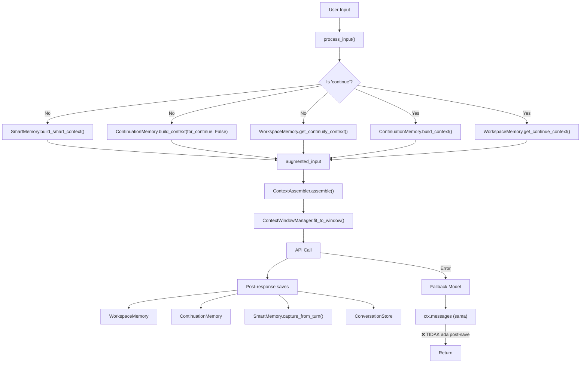

# 🧠 SquidWings Brain System — Full Review & Rekomendasi

> [!IMPORTANT]
> Review ini mencakup **seluruh memory pipeline**: dari disk state → context assembly → prompt injection → fallback → post-response save. Fokus pada **bug, cacat desain, dan optimasi** agar agent mengingat semua dan tidak perlu jelaskan ulang saat fallback atau chat baru.

---

## Arsitektur Memory Saat Ini



---

## 🔴 BUG KRITIS

### 1. Fallback Path Tidak Menyimpan Memory Apapun
**File**: [main.py L1708-1743](file:///home/wira/Documents/agent/workspace/SquidWings/main.py#L1708-L1743)

```python
# Fallback path (except block):
if fb_model:
    raw_response = await api_client.chat_completion(...)
    parsed = ResponseHandler.handle(raw_response)
    final_text = parsed.content or ""
    
    if active_workspace and active_workspace.is_dir():
        _apply_workspace_changes(active_workspace, final_text)
    
    render_terminal_markdown(...)
    return final_text  # ← LANGSUNG RETURN!
```

**Masalah**: Saat fallback sukses, TIDAK ada:
- `save_last_response()` → chat berikutnya tidak tahu output terakhir
- `analyze_and_save()` → continuation memory kosong
- `conversation_store.add_message()` → history hilang
- `record_progress()` → state.json tidak update
- `capture_from_turn()` → decisions/facts tidak terdeteksi

**Dampak**: Setelah fallback, **agent amnesia total**. Chat berikutnya mulai dari nol.

**Fix**:
```python
if fb_model:
    # ... existing call ...
    
    # TAMBAH: Save semua memory sama seperti happy path
    if _ws_memory:
        _ws_memory.save_last_response(final_text, model_id=fb_model.id)
        _ws_memory.record_model(fb_model.id)
        _ws_memory.record_progress("response", "done",
            f"Fallback ok, model={fb_model.id}")
    if _cont_memory:
        _cont_memory.analyze_and_save(
            final_text, model_id=fb_model.id,
            is_truncated=(parsed.finish_reason == "length"))
    conversation_store.add_message(session_id, "user", user_input)
    conversation_store.add_message(session_id, "assistant", final_text,
        model_used=fb_model.id)
    
    return final_text
```

---

### 2. ContextRanker.rank() Tidak Set `original_index` → `select_top()` Selalu Kosong
**File**: [context_ranker.py L96-101](file:///home/wira/Documents/agent/workspace/SquidWings/brain/context/context_ranker.py#L96-L101)

```python
ranked.append(RankedContext(
    content=content,
    source=source,
    score=score,
    token_count=token_count,
    # ← original_index TIDAK di-set! Default = -1
))
```

Lalu di `select_top()`:
```python
for candidate in ranked:
    index = candidate.original_index  # ← Selalu -1
    if not 0 <= index < len(context_pieces):  # ← -1 < 0 → skip SEMUA
        continue
```

**Dampak**: `select_top()` **selalu return list kosong**. History TIDAK PERNAH masuk ke prompt.

**Fix**:
```python
ranked.append(RankedContext(
    content=content,
    source=source,
    score=score,
    token_count=token_count,
    original_index=i,  # ← TAMBAH INI
))
```

---

### 3. Memory Context Di-inject Sebagai User Message, Bukan System
**File**: [main.py L1150-1171](file:///home/wira/Documents/agent/workspace/SquidWings/main.py#L1150-L1171)

Semua context (workspace state, continuity, memory summary) di-concat ke `augmented_input` yang masuk sebagai `user` message via `MessageBuilder.build()`. Ini berarti:

1. **Context window manager bisa drop memory saat trimming** — karena itu bukan `system` message, dia bisa dianggap "optional history"
2. **Token bloat** — 2000+ chars memory + 2000+ chars continuity + 30000 bytes workspace context **semuanya masuk di satu user message** yang makan token besar

**Rekomendasi**: Pisahkan memory context ke `system` message terpisah, atau setidaknya mark sebagai protected di context window manager.

---

## 🟡 CACAT DESAIN

### 4. Tiga Sistem Memory Overlap, Tidak Terkoordinasi

| Sistem | File Disk | Apa yang Disimpan |
|--------|-----------|-------------------|
| `PersistentMemory` | `brain/memory/store/*.json` | files, progress, decisions, facts, model switches |
| `WorkspaceMemory` | `.agent_memory/state.json` | files, progress, decisions, facts, model history |
| `ContinuationMemory` | `.agent_memory/continuation/` | last activity, code buffer |
| `SmartMemory` | wraps `WorkspaceMemory` | scoring + decay + dedup |
| `ConversationStore` | `brain/memory/chat_store/*.json` | full message history |

**Masalah**:
- `PersistentMemory` dan `WorkspaceMemory` simpan data **hampir identik** (files, progress, decisions, facts) tapi di lokasi berbeda
- `PersistentMemory` dipakai saat startup (`_startup_memory` L1795-1800) tapi **TIDAK pernah di-write setelah turn** — hanya `WorkspaceMemory` yang di-write
- `SmartMemory` wrap `WorkspaceMemory` tapi di-instantiate ulang **setiap turn** (L1155: `_smart = SmartMemory(active_workspace)`) — cache scoring hilang

**Rekomendasi**:
- **Hapus `PersistentMemory`** atau merge ke `WorkspaceMemory`. Sekarang ini dead write — data di `brain/memory/store/` kemungkinan stale
- Buat `SmartMemory` singleton per workspace, bukan re-instantiate setiap turn

---

### 5. `summary_compressor` Tidak Terintegrasi
**File**: [summary_compressor.py](file:///home/wira/Documents/agent/workspace/SquidWings/brain/memory/summary_compressor.py)

Module ini ada tapi **TIDAK dipanggil dari mana-mana** di main.py atau context assembler. Artinya:
- History conversation **tidak pernah di-compress**
- Saat context window penuh, `ContextWindowManager` langsung **drop messages** tanpa membuat summary terlebih dahulu
- Setelah trim, informasi hilang permanen

**Rekomendasi**: Integrasikan `SummaryCompressor` ke `ContextWindowManager.fit_to_window()` — sebelum drop, compress dulu ke summary message.

---

### 6. `WorkspaceMemory.build_smart_context()` Scan Seluruh Workspace Setiap Turn
**File**: [workspace_memory.py L161-216](file:///home/wira/Documents/agent/workspace/SquidWings/brain/memory/workspace_memory.py#L161-L216)

```python
def scan_workspace_files(self):
    for p in sorted(self._ws.rglob("*")):  # ← rglob SETIAP TURN
```

`rglob("*")` traverse seluruh directory tree setiap kali. Untuk workspace besar, ini:
- **Lambat** (I/O disk)
- **Boros** — hash MD5 setiap file yang match

**Rekomendasi**: Cache hasil scan dengan TTL (misal 30 detik), atau gunakan `mtime` directory untuk detect perubahan sebelum full rescan.

---

### 7. `.squidwings/index.json` Scan File di `.venv/`
**File**: [.squidwings/index.json](file:///home/wira/Documents/agent/workspace/SquidWings/.squidwings/index.json)

Vault index berisi 24 notes, tapi **13 di antaranya adalah LICENSE/README dari `.venv/site-packages/`**. Ini berarti:
- Vault context yang di-inject ke system prompt mengandung noise dari pip packages
- Token terbuang untuk info FastAPI SKILL.md, idna LICENSE, dll

**Fix**: Tambah `.venv` ke exclude list di vault scanner (file `boot.py` atau `index.py`).

---

### 8. Continuity Context + Activity Context + Workspace Context = Token Bomb
**File**: [main.py L1162-1171](file:///home/wira/Documents/agent/workspace/SquidWings/main.py#L1162-L1171)

```python
context_parts = []
if ws_context:         # ← sampai 30,000 bytes
    context_parts.append(ws_context)
if activity_ctx:       # ← ~200 bytes
    context_parts.append(activity_ctx)
if continuity_ctx:     # ← sampai 2,500 bytes  
    context_parts.append(continuity_ctx)
context_parts.append(f"[USER REQUEST]\n{user_input}")
augmented_input = "\n\n".join(context_parts)
```

Lalu di L1174:
```python
if memory_context:  # ← PersistentMemory summary, sampai 2,000 chars
    augmented_input = f"{memory_context}\n\n{augmented_input}"
```

**Total worst case**: 30K + 200 + 2.5K + 2K + user input = **~35KB dimasukkan sebagai SATU user message**.

Ini kemudian masuk `ContextAssembler` yang juga menambah `system_prompt` + `think_prompt` + `vault_memory` + `skills_prompt`. Kalau model punya context window 32K tokens, bisa jadi **user message saja sudah makan 70%+ window**, menyisakan sedikit untuk output.

**Rekomendasi**:
- Terapkan budget per-section: misal memory max 500 tokens, workspace file list max 300 tokens, file content max 5K tokens
- Gunakan `SmartMemory.build_summary(token_budget=400)` yang sudah ada, bukan `raw.build_smart_context()` yang unlimited

---

## 🟢 REKOMENDASI EFISIENSI

### 9. Satu Sumber Kebenaran untuk Memory
Konsolidasikan ke arsitektur ini:

```
WorkspaceMemory (state.json)     → SATU-SATUNYA sumber kebenaran
  ├── SmartMemory (scoring layer) → SINGLETON per workspace
  ├── ContinuationMemory          → code buffer saja
  └── ConversationStore           → history messages saja
```

Hapus `PersistentMemory` — fungsinya sudah di-cover oleh `WorkspaceMemory`.

### 10. Buat "Compact Handoff" untuk Fallback & New Chat
Saat ini `get_continuity_context()` kirim 2000 chars raw tail. Lebih baik buat **structured handoff** yang isinya:

```json
{
  "task_in_progress": "Menambahkan web search tool",
  "last_action": "Edited tool/register_tools.py", 
  "files_modified_this_session": ["tool/register_tools.py", "agent/agent_loop.py"],
  "pending_next_steps": ["Run mypy", "Run pytest"],
  "key_decisions": ["Pakai httpx, bukan requests"]
}
```

Ini ~200 tokens vs 2000+ chars raw text. Agent langsung tahu konteks tanpa parsing.

### 11. Fix Urutan Save di Happy Path
**File**: [main.py L1627-1647](file:///home/wira/Documents/agent/workspace/SquidWings/main.py#L1627-L1647)

Sekarang:
1. `save_last_response()` ✅
2. `analyze_and_save()` ✅  
3. `conversation_store.add_message("user", ...)` ← **User message disimpan SETELAH response**
4. `conversation_store.add_message("assistant", ...)`

**Masalah**: Kalau crash antara step 2-3, conversation store kehilangan user message tapi punya assistant response tanpa context.

**Fix**: Simpan user message **sebelum** API call, bukan setelah.

### 12. `SmartMemory.capture_from_turn()` Terlalu Naif
**File**: [smart_memory.py L257-292](file:///home/wira/Documents/agent/workspace/SquidWings/brain/memory/smart_memory.py#L257-L292)

Deteksi decisions hanya cek prefix seperti `"decision:"`, `"we will"`. Ini hampir **tidak pernah match** karena model jarang menulis persis seperti itu. Artinya `facts` dan `decisions` di `state.json` kemungkinan **selalu kosong**.

**Fix**: Buat lebih fleksibel — gunakan regex pattern atau bahkan minta model output structured metadata di akhir response.

---

## 📊 Ringkasan Prioritas

| # | Severity | Issue | Impact |
|---|----------|-------|--------|
| 1 | ✅ FIXED | Fallback tidak save memory | Agent amnesia setelah error |
| 2 | ✅ FIXED | `original_index` tidak di-set | History TIDAK PERNAH masuk prompt |
| 3 | 🟡 TINGGI | Memory sebagai user msg | Bisa di-drop saat trimming |
| 4 | 🟡 TINGGI | 3 sistem overlap | Confusion, stale data |
| 5 | 🟡 SEDANG | Compressor tidak dipakai | History hilang tanpa summary |
| 6 | 🟡 SEDANG | rglob setiap turn | Lambat di workspace besar |
| 7 | ✅ FIXED | Vault index rebuilt (`.venv/` cleaned) | Token waste di system prompt |
| 8 | ✅ FIXED | Token bomb (vendor & uncapped files) | Context window habis & fallback eror |
| 9-12 | 🟢 IMPROVE | Berbagai optimasi | Efisiensi jangka panjang |

---

> [!TIP]
> **Quick win terbesar**: Fix bug #1 (fallback save) dan #2 (original_index). Dua fix ini saja sudah akan membuat agent jauh lebih "ingat" antar sesi dan antar model switch.
