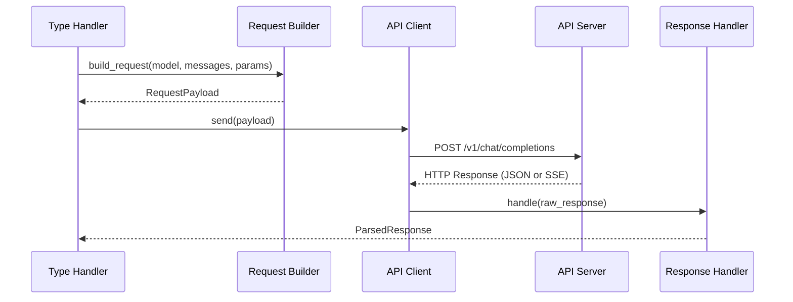
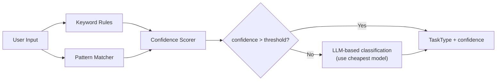
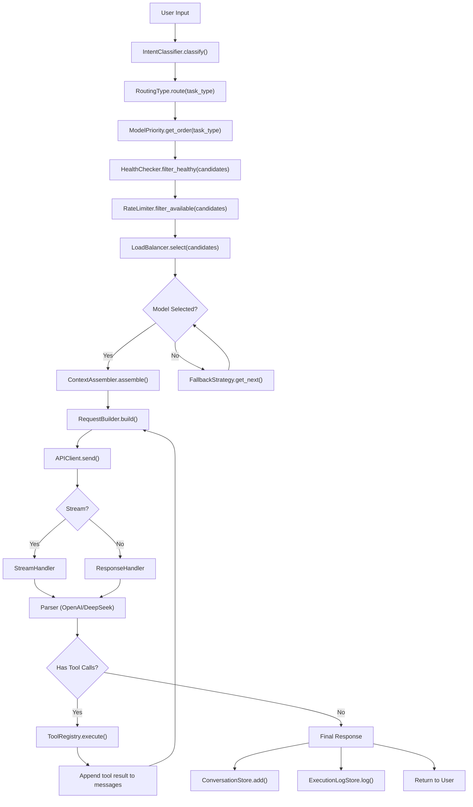
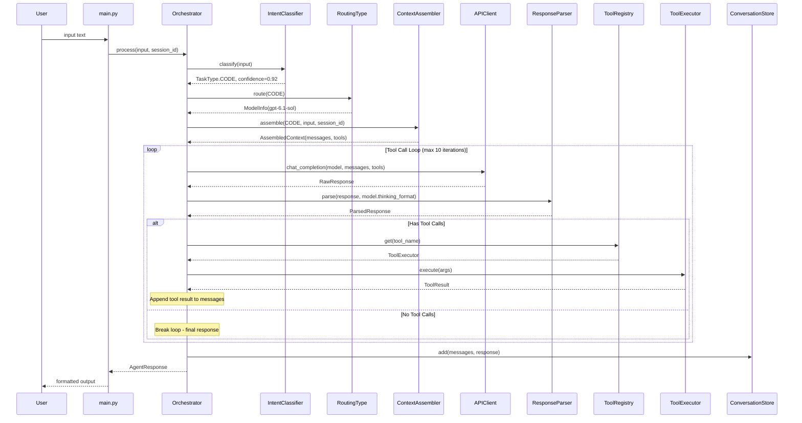
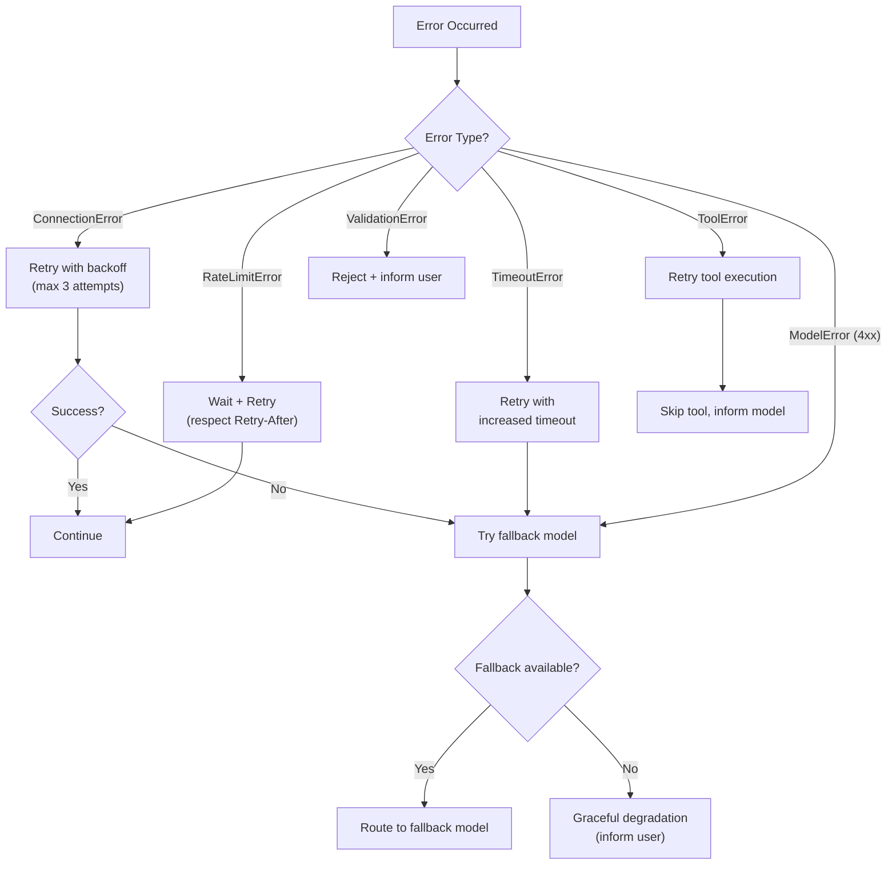
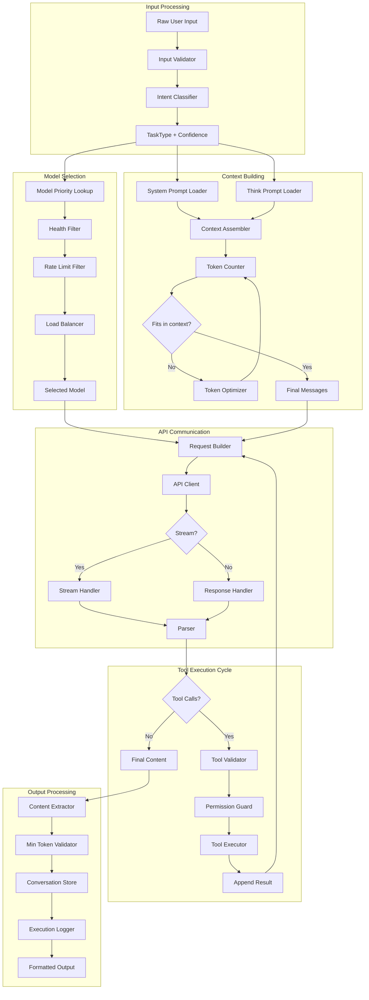
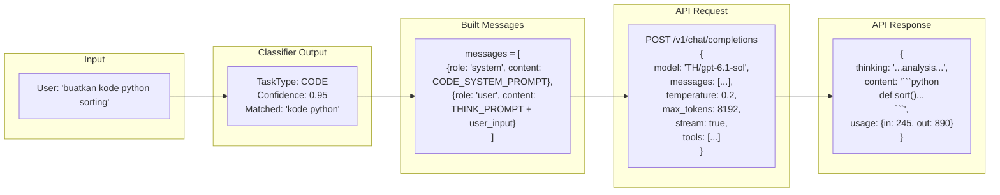
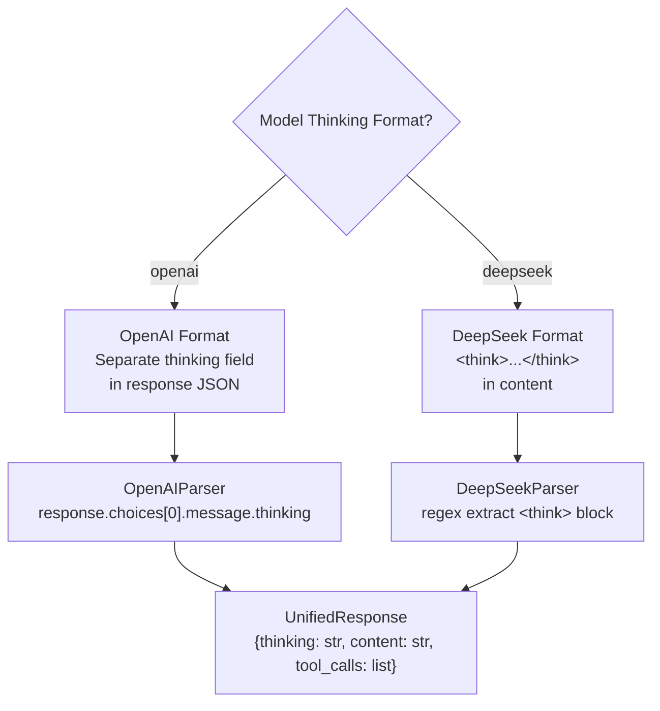
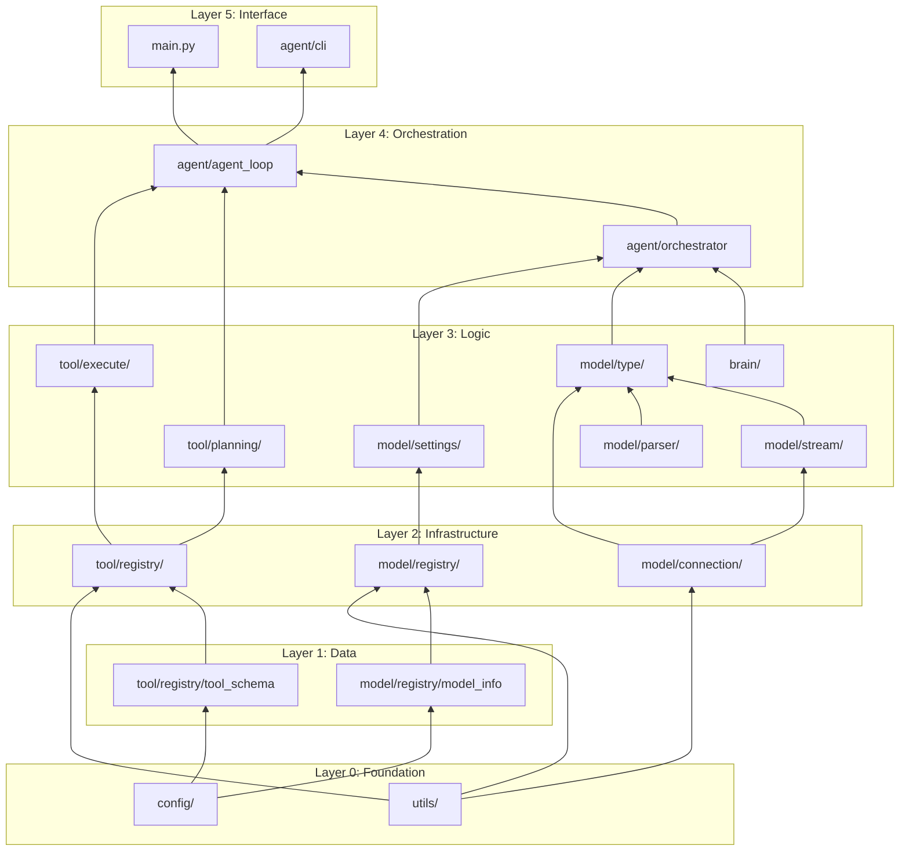

# 🏗️ IMPLEMENTATION PLAN — Agent Router System
## Multi-Model Intelligent Agent dengan 10 Router Models

---

## 📋 Table of Contents

1. [Project Overview](#1-project-overview)
2. [Model Inventory & Capabilities Matrix](#2-model-inventory--capabilities-matrix)
3. [Architecture Overview](#3-architecture-overview)
4. [Full Directory Structure](#4-full-directory-structure)
5. [Phase 0 — Foundation & Configuration](#5-phase-0--foundation--configuration)
6. [Phase 1 — Model Layer](#6-phase-1--model-layer)
7. [Phase 2 — Brain Layer](#7-phase-2--brain-layer)
8. [Phase 3 — Tool Layer](#8-phase-3--tool-layer)
9. [Phase 4 — Router & Orchestration](#9-phase-4--router--orchestration)
10. [Phase 5 — Execution Pipeline](#10-phase-5--execution-pipeline)
11. [Phase 6 — Error Handling & Resilience](#11-phase-6--error-handling--resilience)
12. [Phase 7 — Logging, Monitoring & Telemetry](#12-phase-7--logging-monitoring--telemetry)
13. [Phase 8 — Testing Strategy](#13-phase-8--testing-strategy)
14. [Phase 9 — Integration & End-to-End Flow](#14-phase-9--integration--end-to-end-flow)
15. [Data Flow Diagrams](#15-data-flow-diagrams)
16. [Dependency Graph](#16-dependency-graph)
17. [Detailed Task Checklist](#17-detailed-task-checklist)

---

## 1. Project Overview

### Tujuan
Membangun sebuah **Intelligent Agent System** berbasis Python yang:
- Terkoneksi ke **10 model AI** melalui OpenAI-compatible API (`http://localhost:20128/v1`)
- Memiliki **smart routing** — secara otomatis memilih model yang tepat berdasarkan jenis task
- Memiliki **brain system** — prompt engineering & thinking strategy per task type
- Memiliki **tool system** — kemampuan eksekusi aksi nyata (command prompt, file editing, file upload, file discard)
- Memiliki **planning system** — perencanaan task sebelum eksekusi, dengan database, flow, dan logic

### Filosofi Desain
- **Separation of Concerns**: Setiap layer (model, brain, tool) sepenuhnya terpisah dan independen
- **Plugin-like Architecture**: Mudah menambah model baru, tool baru, atau prompt baru
- **Config-driven**: Semua konfigurasi di satu tempat, tidak hardcoded
- **Fail-safe**: Retry, fallback, graceful degradation

---

## 2. Model Inventory & Capabilities Matrix

> [!IMPORTANT]
> Data berikut di-fetch langsung dari `http://localhost:20128/v1/models` pada 2026-10-05

| # | Model ID | Vision | Audio In | Video In | Search | Tools | Reasoning | Thinking Format | Think Disable | Think Effort | Context Window | Max Output |
|---|----------|--------|----------|----------|--------|-------|-----------|-----------------|---------------|--------------|----------------|------------|
| 1 | `TH/gpt-6-sol` | ✅ | ❌ | ❌ | ✅ | ✅ | ✅ | openai | ✅ | ❌ | 1,050,000 | 128,000 |
| 2 | `TH/gpt-6-sol-fast` | ✅ | ❌ | ❌ | ✅ | ✅ | ✅ | openai | ✅ | ❌ | 1,050,000 | 128,000 |
| 3 | `TH/gpt-6.1-sol` | ✅ | ❌ | ❌ | ✅ | ✅ | ✅ | openai | ✅ | ❌ | 1,050,000 | 128,000 |
| 4 | `TH/gpt-6.1-sol-fast` | ✅ | ❌ | ❌ | ✅ | ✅ | ✅ | openai | ✅ | ❌ | 1,050,000 | 128,000 |
| 5 | `TH/deepseek-v4.1-flash-fast` | ✅ | ❌ | ❌ | ❌ | ✅ | ✅ | deepseek | ✅ | ✅ | 1,000,000 | 128,000 |
| 6 | `TH/deepseek-v4-flash:free` | ❌ | ❌ | ❌ | ❌ | ✅ | ✅ | deepseek | ✅ | ✅ | 1,000,000 | 384,000 |
| 7 | `TH/deepseek-v4.1-flash:free` | ✅ | ❌ | ❌ | ❌ | ✅ | ✅ | deepseek | ✅ | ✅ | 1,000,000 | 128,000 |
| 8 | `TH/mimo-v2.5:free` | ✅ | ✅ | ✅ | ❌ | ✅ | ✅ | deepseek | ❌ | ❌ | 1,048,576 | 131,072 |
| 9 | `TH/mimo-v2.6-flash:free` | ✅ | ✅ | ✅ | ❌ | ✅ | ✅ | deepseek | ❌ | ❌ | 1,048,576 | 131,072 |
| 10 | *(1 model lagi dari fetch awal yang terpotong — kemungkinan model pertama di list)* | — | — | — | — | — | — | — | — | — | — | — |

### Klasifikasi Model berdasarkan Keunggulan

| Kategori | Model yang Cocok | Alasan |
|----------|------------------|--------|
| **Code** (coding tasks) | `gpt-6.1-sol`, `deepseek-v4.1-flash-fast` | Reasoning kuat, tool support, context besar |
| **Math** (kalkulasi, rumus) | `gpt-6.1-sol`, `gpt-6-sol` | Reasoning format openai, search enabled |
| **Activity** (general tasks) | `gpt-6-sol-fast`, `gpt-6.1-sol-fast` | Fast variant, general purpose |
| **School Task** | `gpt-6.1-sol`, `deepseek-v4-flash:free` | Max output 384K (deepseek), reasoning |
| **Generate Image** | `mimo-v2.5:free`, `mimo-v2.6-flash:free` | Vision + Audio + Video input support |
| **Reasoning** (deep thinking) | `gpt-6.1-sol`, `deepseek-v4.1-flash-fast` | Extended thinking, effort control |
| **Multimodal** | `mimo-v2.5:free`, `mimo-v2.6-flash:free` | Full multimodal support |
| **Free Tier / Cost-Saving** | `deepseek-v4-flash:free`, `deepseek-v4.1-flash:free`, `mimo-*:free` | Free models for non-critical tasks |
| **High Volume Output** | `deepseek-v4-flash:free` | 384,000 max output tokens |

---

## 3. Architecture Overview

```mermaid
graph TB
    subgraph "🎯 Entry Point"
        MAIN["main.py<br/>CLI / API Entry"]
    end

    subgraph "🧠 Brain Layer"
        CLASSIFIER["Intent Classifier<br/>brain/classifier/"]
        PROMPT_THINK["Prompt Must Think<br/>brain/prompt_must_think/"]
        PROMPT_SYS["System Prompts<br/>brain/system_prompt/"]
        TOKEN_GEN["Token Generator<br/>brain/generate_efficient_token/"]
        TOKEN_MAX["Max Token Config<br/>brain/max_token/"]
        TOKEN_MIN["Min Token Config<br/>brain/min_token/"]
        MEMORY["Conversation Memory<br/>brain/memory/"]
        CTX_MGR["Context Manager<br/>brain/context/"]
    end

    subgraph "🔀 Router Layer"
        ROUTER["Smart Router<br/>model/settings/routing_type.py"]
        FALLBACK["Fallback Strategy<br/>model/settings/fallback.py"]
        LOAD_BAL["Load Balancer<br/>model/settings/load_balancer.py"]
    end

    subgraph "🤖 Model Layer"
        CONN["API Connection<br/>model/connection/"]
        REG["Model Registry<br/>model/registry/"]
        TYPE_CODE["Code Handler<br/>model/type/code.py"]
        TYPE_MATH["Math Handler<br/>model/type/math.py"]
        TYPE_ACT["Activity Handler<br/>model/type/activity.py"]
        TYPE_SCHOOL["School Handler<br/>model/type/school_task.py"]
        TYPE_IMG["Image Handler<br/>model/type/generate_img.py"]
        TYPE_REASON["Reason Handler<br/>model/type/reason.py"]
        TYPE_MULTI["Multimodal Handler<br/>model/type/multimodal.py"]
        RESP_PARSE["Response Parser<br/>model/parser/"]
        STREAM["Stream Handler<br/>model/stream/"]
    end

    subgraph "🔧 Tool Layer"
        TOOL_REG["Tool Registry<br/>tool/registry/"]
        EXEC_CMD["Execute CMD<br/>tool/execute/execute_command_prompt/"]
        EXEC_EDIT["Edit File<br/>tool/execute/execute_edit_change_file/"]
        EXEC_DISC["Discard File<br/>tool/execute/execute_discard_change_file/"]
        EXEC_UPLOAD["Upload File<br/>tool/execute/execute_upload_file/"]
        PLAN_DB["Planning DB<br/>tool/planning/database/"]
        PLAN_FLOW["Planning Flow<br/>tool/planning/flow/"]
        PLAN_LOGIC["Planning Logic<br/>tool/planning/logic/"]
        SANDBOX["Sandbox<br/>tool/sandbox/"]
    end

    subgraph "⚙️ Config & Infra"
        CONFIG["config/<br/>settings.py, secrets.py"]
        LOGGER["utils/logger.py"]
        EXCEPTIONS["utils/exceptions.py"]
        VALIDATORS["utils/validators.py"]
        RETRY["utils/retry.py"]
    end

    MAIN --> CLASSIFIER
    CLASSIFIER --> ROUTER
    ROUTER --> CONN
    CONN --> TYPE_CODE & TYPE_MATH & TYPE_ACT & TYPE_SCHOOL & TYPE_IMG & TYPE_REASON & TYPE_MULTI
    CLASSIFIER --> PROMPT_THINK & PROMPT_SYS
    PROMPT_THINK --> TOKEN_GEN & TOKEN_MAX & TOKEN_MIN
    TYPE_CODE & TYPE_MATH --> EXEC_CMD & EXEC_EDIT
    TYPE_ACT --> PLAN_FLOW & PLAN_LOGIC
    ROUTER --> FALLBACK & LOAD_BAL
    TYPE_CODE --> RESP_PARSE --> STREAM
    EXEC_CMD & EXEC_EDIT & EXEC_DISC & EXEC_UPLOAD --> SANDBOX
    PLAN_DB & PLAN_FLOW & PLAN_LOGIC --> TOOL_REG
    CONFIG --> CONN & ROUTER & LOGGER
```



---

## 4. Full Directory Structure

> [!NOTE]
> Struktur existing (sudah ada) ditandai ✅, yang perlu dibuat ditandai 🆕

```
agent/
├── main.py                                        🆕  Entry point utama
├── requirements.txt                               🆕  Python dependencies
├── .env                                           🆕  Environment variables (secrets)
├── .env.example                                   🆕  Template env
├── pyproject.toml                                 🆕  Project metadata & tooling config
├── README.md                                      🆕  Project documentation
│
├── config/                                        🆕  Global configuration
│   ├── __init__.py                                🆕
│   ├── settings.py                                🆕  App settings (base_url, timeouts, etc.)
│   ├── secrets.py                                 🆕  API key management
│   ├── constants.py                               🆕  Global constants & enums
│   └── models_config.yaml                         🆕  Model capabilities config (dari API fetch)
│
├── brain/                                         ✅  Exists
│   ├── __init__.py                                🆕
│   ├── classifier/                                🆕  Intent classification
│   │   ├── __init__.py                            🆕
│   │   ├── intent_classifier.py                   🆕  Classify user input → task type
│   │   ├── keyword_rules.py                       🆕  Rule-based keyword matching
│   │   ├── pattern_matcher.py                     🆕  Regex/pattern-based classification
│   │   └── confidence_scorer.py                   🆕  Confidence scoring untuk classification
│   │
│   ├── prompt_must_think/                         ✅  Exists
│   │   ├── __init__.py                            🆕
│   │   ├── base_think_prompt.py                   🆕  Base class untuk thinking prompts
│   │   ├── for_activity.txt                       ✅  Exists (empty)
│   │   ├── for_code.txt                           ✅  Exists (empty)
│   │   ├── for_math.txt                           ✅  Exists (empty)
│   │   ├── for_reason.txt                         ✅  Exists (empty)
│   │   └── for_solve_school_task.txt              ✅  Exists (empty)
│   │
│   ├── system_prompt/                             🆕  System prompts per task type
│   │   ├── __init__.py                            🆕
│   │   ├── base_system_prompt.py                  🆕  Base class untuk system prompts
│   │   ├── code_system_prompt.txt                 🆕
│   │   ├── math_system_prompt.txt                 🆕
│   │   ├── activity_system_prompt.txt             🆕
│   │   ├── school_system_prompt.txt               🆕
│   │   ├── reason_system_prompt.txt               🆕
│   │   └── multimodal_system_prompt.txt           🆕
│   │
│   ├── generate_efficient_token/                  ✅  Exists (empty)
│   │   ├── __init__.py                            🆕
│   │   ├── token_optimizer.py                     🆕  Token usage optimization logic
│   │   ├── compression_strategy.py                🆕  Prompt compression strategies
│   │   └── token_counter.py                       🆕  Count tokens sebelum kirim
│   │
│   ├── max_token/                                 ✅  Exists (empty)
│   │   ├── __init__.py                            🆕
│   │   ├── max_token_config.py                    🆕  Max token limits per model
│   │   └── max_token_calculator.py                🆕  Dynamic max token calculation
│   │
│   ├── min_token/                                 ✅  Exists (empty)
│   │   ├── __init__.py                            🆕
│   │   ├── min_token_config.py                    🆕  Min token thresholds per model
│   │   └── min_token_validator.py                 🆕  Validate output meets min threshold
│   │
│   ├── memory/                                    🆕  Conversation memory
│   │   ├── __init__.py                            🆕
│   │   ├── conversation_store.py                  🆕  Store conversation history
│   │   ├── message_builder.py                     🆕  Build message payloads
│   │   ├── context_window_manager.py              🆕  Manage context window limits
│   │   └── summary_compressor.py                  🆕  Compress old messages
│   │
│   └── context/                                   🆕  Context management
│       ├── __init__.py                            🆕
│       ├── context_assembler.py                   🆕  Assemble final context (system + user + history)
│       └── context_ranker.py                      🆕  Rank relevance of context pieces
│
├── model/                                         ✅  Exists
│   ├── __init__.py                                🆕
│   │
│   ├── connection/                                🆕  API connection layer
│   │   ├── __init__.py                            🆕
│   │   ├── base_client.py                         🆕  Base HTTP client (OpenAI-compatible)
│   │   ├── api_client.py                          🆕  Concrete API client implementation
│   │   ├── request_builder.py                     🆕  Build API request payloads
│   │   ├── response_handler.py                    🆕  Handle API responses
│   │   └── health_check.py                        🆕  Model endpoint health checking
│   │
│   ├── registry/                                  🆕  Model registry & discovery
│   │   ├── __init__.py                            🆕
│   │   ├── model_registry.py                      🆕  Register & lookup models
│   │   ├── model_info.py                          🆕  Model dataclass (id, capabilities, etc.)
│   │   ├── model_fetcher.py                       🆕  Fetch models dari /v1/models endpoint
│   │   └── capability_matcher.py                  🆕  Match task requirements → model capabilities
│   │
│   ├── settings/                                  ✅  Exists
│   │   ├── __init__.py                            🆕
│   │   ├── routing_type.py                        ✅  Exists (empty) — routing rules
│   │   ├── fallback.py                            🆕  Fallback chains per task type
│   │   ├── load_balancer.py                       🆕  Load balancing across models
│   │   ├── rate_limiter.py                        🆕  Rate limiting per model
│   │   └── model_priority.py                      🆕  Priority ordering per task
│   │
│   ├── type/                                      ✅  Exists
│   │   ├── __init__.py                            🆕
│   │   ├── base_handler.py                        🆕  Abstract base for all type handlers
│   │   ├── code.py                                ✅  Exists (empty) — code generation handler
│   │   ├── math.py                                ✅  Exists (empty) — math solving handler
│   │   ├── activity.py                            ✅  Exists (empty) — general activity handler
│   │   ├── school_task.py                         ✅  Exists (empty) — school task handler
│   │   ├── generate_img.py                        ✅  Exists (empty) — image generation handler
│   │   ├── reason.py                              🆕  Reasoning/deep thinking handler
│   │   └── multimodal.py                          🆕  Multimodal (audio/video/image) handler
│   │
│   ├── parser/                                    🆕  Response parsing
│   │   ├── __init__.py                            🆕
│   │   ├── base_parser.py                         🆕  Base response parser
│   │   ├── openai_parser.py                       🆕  Parse openai-format thinking
│   │   ├── deepseek_parser.py                     🆕  Parse deepseek-format thinking
│   │   ├── tool_call_parser.py                    🆕  Parse tool calls dari response
│   │   └── content_extractor.py                   🆕  Extract content blocks
│   │
│   └── stream/                                    🆕  Streaming support
│       ├── __init__.py                            🆕
│       ├── stream_handler.py                      🆕  Handle SSE/streaming responses
│       ├── stream_processor.py                    🆕  Process stream chunks
│       └── stream_aggregator.py                   🆕  Aggregate streamed chunks → full response
│
├── tool/                                          ✅  Exists
│   ├── __init__.py                                🆕
│   │
│   ├── registry/                                  🆕  Tool registry
│   │   ├── __init__.py                            🆕
│   │   ├── tool_registry.py                       🆕  Register, discover, lookup tools
│   │   ├── tool_schema.py                         🆕  Tool schema (OpenAI function calling format)
│   │   └── tool_validator.py                      🆕  Validate tool call arguments
│   │
│   ├── execute/                                   ✅  Exists
│   │   ├── __init__.py                            🆕
│   │   ├── base_executor.py                       🆕  Abstract base executor
│   │   │
│   │   ├── execute_command_prompt/                ✅  Exists (empty)
│   │   │   ├── __init__.py                        🆕
│   │   │   ├── command_executor.py                🆕  Execute shell commands
│   │   │   ├── command_sanitizer.py               🆕  Sanitize/validate commands
│   │   │   ├── command_output_parser.py           🆕  Parse command output
│   │   │   └── allowed_commands.yaml              🆕  Whitelist of allowed commands
│   │   │
│   │   ├── execute_edit_change_file/              ✅  Exists (empty)
│   │   │   ├── __init__.py                        🆕
│   │   │   ├── file_editor.py                     🆕  Apply file edits (create/modify/delete)
│   │   │   ├── diff_generator.py                  🆕  Generate diffs
│   │   │   ├── edit_validator.py                  🆕  Validate edits before applying
│   │   │   └── backup_manager.py                  🆕  Backup files before editing
│   │   │
│   │   ├── execute_discard_change_file/           ✅  Exists (empty)
│   │   │   ├── __init__.py                        🆕
│   │   │   ├── discard_handler.py                 🆕  Discard/revert file changes
│   │   │   ├── git_integration.py                 🆕  Git-based revert
│   │   │   └── change_tracker.py                  🆕  Track what changes were made
│   │   │
│   │   └── execute_upload_file/                   ✅  Exists (empty)
│   │       ├── __init__.py                        🆕
│   │       ├── upload_handler.py                  🆕  Handle file uploads
│   │       ├── file_validator.py                  🆕  Validate file types & sizes
│   │       └── storage_manager.py                 🆕  Manage uploaded file storage
│   │
│   ├── planning/                                  ✅  Exists
│   │   ├── __init__.py                            🆕
│   │   ├── base_planner.py                        🆕  Abstract base planner
│   │   │
│   │   ├── database/                              ✅  Exists (empty)
│   │   │   ├── __init__.py                        🆕
│   │   │   ├── plan_store.py                      🆕  Store plans in SQLite/JSON
│   │   │   ├── task_store.py                      🆕  Store individual task records
│   │   │   ├── execution_log_store.py             🆕  Store execution logs
│   │   │   └── schema.py                          🆕  Database schema definitions
│   │   │
│   │   ├── flow/                                  ✅  Exists (empty)
│   │   │   ├── __init__.py                        🆕
│   │   │   ├── flow_engine.py                     🆕  Execute planning flows (DAG)
│   │   │   ├── flow_builder.py                    🆕  Build execution flows
│   │   │   ├── step_executor.py                   🆕  Execute individual flow steps
│   │   │   ├── flow_visualizer.py                 🆕  Visualize flows
│   │   │   └── flow_templates.py                  🆕  Pre-built flow templates
│   │   │
│   │   └── logic/                                 ✅  Exists (empty)
│   │       ├── __init__.py                        🆕
│   │       ├── decomposer.py                      🆕  Decompose complex tasks → sub-tasks
│   │       ├── dependency_resolver.py             🆕  Resolve dependencies between tasks
│   │       ├── priority_calculator.py             🆕  Calculate task priorities
│   │       └── constraint_checker.py              🆕  Check constraints sebelum eksekusi
│   │
│   └── sandbox/                                   🆕  Isolated execution environment
│       ├── __init__.py                            🆕
│       ├── sandbox_manager.py                     🆕  Manage sandbox lifecycle
│       ├── permission_guard.py                    🆕  Permission checking
│       └── resource_limiter.py                    🆕  Resource limits (CPU, memory, time)
│
├── utils/                                         🆕  Shared utilities
│   ├── __init__.py                                🆕
│   ├── logger.py                                  🆕  Structured logging
│   ├── exceptions.py                              🆕  Custom exception hierarchy
│   ├── validators.py                              🆕  Input validators
│   ├── retry.py                                   🆕  Retry logic with backoff
│   ├── event_bus.py                               🆕  Event bus for decoupled communication
│   ├── timer.py                                   🆕  Performance timer / profiler
│   └── helpers.py                                 🆕  Misc helper functions
│
└── tests/                                         🆕  Test suite
    ├── __init__.py                                🆕
    ├── conftest.py                                🆕  Shared fixtures
    ├── test_config/                               🆕
    ├── test_brain/                                🆕
    ├── test_model/                                🆕
    ├── test_tool/                                 🆕
    └── test_integration/                          🆕
```

---

## 5. Phase 0 — Foundation & Configuration

### 5.1 Environment & Dependencies

| Task ID | Task | File | Detail |
|---------|------|------|--------|
| P0-001 | Buat `requirements.txt` | `requirements.txt` | `httpx>=0.27`, `pydantic>=2.0`, `python-dotenv`, `pyyaml`, `tiktoken`, `rich`, `tenacity`, `pytest`, `pytest-asyncio` |
| P0-002 | Buat `pyproject.toml` | `pyproject.toml` | Project metadata, Python ≥3.11, tool configs (ruff, mypy, pytest) |
| P0-003 | Buat `.env.example` | `.env.example` | Template: `API_BASE_URL`, `API_KEY`, `LOG_LEVEL`, `MAX_RETRIES`, `TIMEOUT_SECONDS` |
| P0-004 | Buat `.env` | `.env` | Actual values: `API_BASE_URL=http://localhost:20128/v1`, `API_KEY=sk-d9d07e75b9c98f5c-2jf8v2-08086f60` |
| P0-005 | Buat `.gitignore` | `.gitignore` | Python standard + `.env`, `__pycache__`, `.pytest_cache`, `*.pyc` |

### 5.2 Config Module

| Task ID | Task | File | Detail |
|---------|------|------|--------|
| P0-006 | Config `__init__.py` | `config/__init__.py` | Export `Settings`, `Secrets`, `Constants` |
| P0-007 | `settings.py` | `config/settings.py` | Pydantic `BaseSettings` class. Fields: `api_base_url`, `default_timeout`, `max_retries`, `retry_backoff`, `log_level`, `stream_enabled`, `default_model` |
| P0-008 | `secrets.py` | `config/secrets.py` | Load API key dari env. Validate format. Mask in logs |
| P0-009 | `constants.py` | `config/constants.py` | Enums: `TaskType` (CODE, MATH, ACTIVITY, SCHOOL_TASK, GENERATE_IMG, REASON, MULTIMODAL), `ModelProvider` (OPENAI_FORMAT, DEEPSEEK_FORMAT), `ThinkingFormat`, status codes |
| P0-010 | `models_config.yaml` | `config/models_config.yaml` | YAML dump dari semua 10 model + capabilities + routing preferences |

### 5.3 Utils Module

| Task ID | Task | File | Detail |
|---------|------|------|--------|
| P0-011 | `exceptions.py` | `utils/exceptions.py` | Exception hierarchy: `AgentError` → `ModelError`, `ConnectionError`, `RouterError`, `ToolError`, `BrainError`, `ValidationError`, `TimeoutError`, `RateLimitError`, `FallbackExhaustedError` |
| P0-012 | `logger.py` | `utils/logger.py` | Structured logging via `logging` + `rich`. Per-module loggers, colored output, file rotation. Fields: timestamp, level, module, message, extras |
| P0-013 | `retry.py` | `utils/retry.py` | Decorator `@with_retry(max_attempts, backoff_factor, retryable_exceptions)`. Uses `tenacity` or custom. Exponential backoff with jitter |
| P0-014 | `validators.py` | `utils/validators.py` | Functions: `validate_model_id()`, `validate_api_key()`, `validate_message_format()`, `validate_tool_call()` |
| P0-015 | `event_bus.py` | `utils/event_bus.py` | Simple pub/sub event bus. Events: `model_selected`, `request_sent`, `response_received`, `tool_called`, `error_occurred` |
| P0-016 | `timer.py` | `utils/timer.py` | Context manager `Timer()` untuk measure execution time. Decorator `@timed` |
| P0-017 | `helpers.py` | `utils/helpers.py` | `truncate_string()`, `format_tokens()`, `safe_json_loads()`, `merge_dicts()`, `generate_request_id()` |

---

## 6. Phase 1 — Model Layer

### 6.1 Connection Sublayer



| Task ID | Task | File | Detail |
|---------|------|------|--------|
| P1-001 | `base_client.py` | `model/connection/base_client.py` | Abstract class `BaseClient` dengan method: `send_request()`, `send_stream()`, `health_check()`, `close()`. Properties: `base_url`, `api_key`, `timeout`, `headers` |
| P1-002 | `api_client.py` | `model/connection/api_client.py` | Concrete `APIClient(BaseClient)` menggunakan `httpx.AsyncClient`. Connection pooling, keep-alive. Methods: `chat_completion()`, `chat_completion_stream()`, `list_models()` |
| P1-003 | `request_builder.py` | `model/connection/request_builder.py` | Class `RequestBuilder`. Methods: `build_chat_request(model, messages, temperature, max_tokens, tools, stream, thinking_config)` → returns dict. Handles both openai & deepseek thinking formats |
| P1-004 | `response_handler.py` | `model/connection/response_handler.py` | Class `ResponseHandler`. Methods: `handle_success()`, `handle_error()`, `extract_usage()`, `extract_content()`, `extract_tool_calls()`, `extract_thinking()` |
| P1-005 | `health_check.py` | `model/connection/health_check.py` | Class `HealthChecker`. Method: `check_model(model_id) → HealthStatus`. Periodic health check loop. Marks models as healthy/unhealthy |

### 6.2 Registry Sublayer

| Task ID | Task | File | Detail |
|---------|------|------|--------|
| P1-006 | `model_info.py` | `model/registry/model_info.py` | Pydantic `ModelInfo` dataclass: `id`, `owned_by`, `capabilities` (vision, pdf, audio_input, video_input, image_output, audio_output, search, tools, reasoning, thinking_format, thinking_can_disable, thinking_range, thinking_effort_supported, context_window, max_output). Methods: `supports_vision()`, `supports_tools()`, `supports_reasoning()`, `get_thinking_format()`, `is_free()` |
| P1-007 | `model_fetcher.py` | `model/registry/model_fetcher.py` | Class `ModelFetcher`. Method: `fetch_all_models() → List[ModelInfo]`. Calls `GET /v1/models`. Parses response into `ModelInfo` objects. Caches result. Auto-refresh interval |
| P1-008 | `model_registry.py` | `model/registry/model_registry.py` | Class `ModelRegistry`. Singleton. Methods: `register(ModelInfo)`, `get(model_id)`, `get_all()`, `get_by_capability(capability)`, `get_by_task_type(TaskType)`, `refresh()`. Internal dict keyed by model_id |
| P1-009 | `capability_matcher.py` | `model/registry/capability_matcher.py` | Class `CapabilityMatcher`. Method: `match(requirements: TaskRequirements) → List[ModelInfo]` sorted by score. Scoring: vision_needed+vision_supported=+10, reasoning_needed+reasoning_supported=+10, free_preferred+is_free=+5, etc. |

### 6.3 Settings Sublayer (Router)

| Task ID | Task | File | Detail |
|---------|------|------|--------|
| P1-010 | `routing_type.py` | `model/settings/routing_type.py` | Class `RoutingType`. Main router logic. Method: `route(task_type: TaskType, requirements: dict) → ModelInfo`. Uses `CapabilityMatcher` + priority config. Maps TaskType → preferred model list |
| P1-011 | `fallback.py` | `model/settings/fallback.py` | Class `FallbackStrategy`. Defines fallback chains: e.g., CODE → `[gpt-6.1-sol, gpt-6-sol, deepseek-v4.1-flash-fast, deepseek-v4.1-flash:free]`. Method: `get_next_fallback(task_type, failed_models) → ModelInfo or None` |
| P1-012 | `load_balancer.py` | `model/settings/load_balancer.py` | Class `LoadBalancer`. Strategies: round-robin, least-connections, weighted. Method: `select(candidates: List[ModelInfo]) → ModelInfo`. Tracks active request counts |
| P1-013 | `rate_limiter.py` | `model/settings/rate_limiter.py` | Class `RateLimiter`. Token bucket algorithm. Per-model limits. Methods: `acquire(model_id) → bool`, `release(model_id)`, `is_available(model_id) → bool` |
| P1-014 | `model_priority.py` | `model/settings/model_priority.py` | Static config class. Priority ordering per TaskType. E.g., `CODE: [gpt-6.1-sol (p=1), deepseek-v4.1-flash-fast (p=2), ...]` |

### 6.4 Type Handlers

| Task ID | Task | File | Detail |
|---------|------|------|--------|
| P1-015 | `base_handler.py` | `model/type/base_handler.py` | Abstract `BaseTypeHandler`. Methods: `prepare_request()`, `execute()`, `parse_response()`, `post_process()`. Properties: `task_type`, `preferred_models`, `system_prompt`, `thinking_prompt` |
| P1-016 | `code.py` | `model/type/code.py` | `CodeHandler(BaseTypeHandler)`. Optimized for coding tasks. Sets `temperature=0.2`, enables tools, includes code-specific system prompt. Post-process: extract code blocks, validate syntax |
| P1-017 | `math.py` | `model/type/math.py` | `MathHandler(BaseTypeHandler)`. `temperature=0.1`, force thinking enabled, include step-by-step prompt. Post-process: extract mathematical expressions, verify calculations |
| P1-018 | `activity.py` | `model/type/activity.py` | `ActivityHandler(BaseTypeHandler)`. General purpose. `temperature=0.7`, balanced settings. Post-process: format output nicely |
| P1-019 | `school_task.py` | `model/type/school_task.py` | `SchoolTaskHandler(BaseTypeHandler)`. `temperature=0.3`, thinking enabled, educational format. Post-process: structured answer with explanation |
| P1-020 | `generate_img.py` | `model/type/generate_img.py` | `GenerateImgHandler(BaseTypeHandler)`. Routes to multimodal models (mimo). Handles image input/output. Special payload construction |
| P1-021 | `reason.py` | `model/type/reason.py` | `ReasonHandler(BaseTypeHandler)`. Deep thinking tasks. `temperature=0.1`, max thinking tokens, effort=high. Post-process: extract reasoning chain |
| P1-022 | `multimodal.py` | `model/type/multimodal.py` | `MultimodalHandler(BaseTypeHandler)`. Handles audio/video/image inputs. Routes to mimo models. Special content block construction |

### 6.5 Parser Sublayer

| Task ID | Task | File | Detail |
|---------|------|------|--------|
| P1-023 | `base_parser.py` | `model/parser/base_parser.py` | Abstract `BaseParser`. Method: `parse(raw_response) → ParsedResponse` |
| P1-024 | `openai_parser.py` | `model/parser/openai_parser.py` | `OpenAIParser(BaseParser)`. Handles openai thinking format. Extracts `thinking` → `content`. Used by GPT models |
| P1-025 | `deepseek_parser.py` | `model/parser/deepseek_parser.py` | `DeepSeekParser(BaseParser)`. Handles deepseek thinking format (`<think>...</think>`). Used by DeepSeek & mimo models |
| P1-026 | `tool_call_parser.py` | `model/parser/tool_call_parser.py` | `ToolCallParser`. Extracts `tool_calls` dari response. Maps to internal tool registry. Validates arguments |
| P1-027 | `content_extractor.py` | `model/parser/content_extractor.py` | `ContentExtractor`. Extracts structured content: code blocks, math expressions, lists, tables. Regex + heuristic based |

### 6.6 Stream Sublayer

| Task ID | Task | File | Detail |
|---------|------|------|--------|
| P1-028 | `stream_handler.py` | `model/stream/stream_handler.py` | `StreamHandler`. Async generator that yields SSE events. Handles `data: [DONE]`. Reconnection on disconnect |
| P1-029 | `stream_processor.py` | `model/stream/stream_processor.py` | `StreamProcessor`. Processes each chunk: extracts delta content, delta tool calls, delta thinking. Emits events |
| P1-030 | `stream_aggregator.py` | `model/stream/stream_aggregator.py` | `StreamAggregator`. Collects all chunks → builds final `ParsedResponse`. Handles partial JSON in tool calls |

---

## 7. Phase 2 — Brain Layer

### 7.1 Classifier Sublayer



| Task ID | Task | File | Detail |
|---------|------|------|--------|
| P2-001 | `keyword_rules.py` | `brain/classifier/keyword_rules.py` | Dict mapping keywords → TaskType. E.g., `{"buatkan kode": CODE, "hitung": MATH, "jelaskan": ACTIVITY, "soal": SCHOOL_TASK, "gambar": GENERATE_IMG, "pikirkan": REASON}`. Support bahasa Indonesia + English |
| P2-002 | `pattern_matcher.py` | `brain/classifier/pattern_matcher.py` | Regex patterns. E.g., `r"(?:buat|tulis|generate).*(?:code|kode|program|script)"` → CODE. Ordered by specificity |
| P2-003 | `confidence_scorer.py` | `brain/classifier/confidence_scorer.py` | `ConfidenceScorer`. Combines keyword score + pattern score + heuristic. Returns `(TaskType, float)`. Threshold: 0.6 |
| P2-004 | `intent_classifier.py` | `brain/classifier/intent_classifier.py` | Main `IntentClassifier` class. Method: `classify(user_input: str) → ClassificationResult(task_type, confidence, matched_rules)`. Falls back to LLM classification if confidence < threshold |

### 7.2 Prompt Must Think

| Task ID | Task | File | Detail |
|---------|------|------|--------|
| P2-005 | `base_think_prompt.py` | `brain/prompt_must_think/base_think_prompt.py` | Class `ThinkPromptManager`. Methods: `get_think_prompt(task_type) → str`, `load_prompt_file(filename) → str`. Template support with `{variables}` |
| P2-006 | Fill `for_code.txt` | `brain/prompt_must_think/for_code.txt` | Thinking prompt untuk code: "Analyze the requirements step by step. Consider edge cases. Plan the architecture before writing code. Think about error handling, performance, and maintainability." |
| P2-007 | Fill `for_math.txt` | `brain/prompt_must_think/for_math.txt` | "Break down the problem. Identify the mathematical concepts needed. Show each step of the solution. Verify your answer by substituting back." |
| P2-008 | Fill `for_activity.txt` | `brain/prompt_must_think/for_activity.txt` | "Consider the context. Think about what the user really needs. Provide actionable and practical advice." |
| P2-009 | Fill `for_reason.txt` | `brain/prompt_must_think/for_reason.txt` | "Think deeply. Consider multiple perspectives. Evaluate evidence. Identify assumptions. Draw logical conclusions." |
| P2-010 | Fill `for_solve_school_task.txt` | `brain/prompt_must_think/for_solve_school_task.txt` | "Identify the subject. Break down the question. Explain each concept clearly. Provide step-by-step solution. Add helpful tips for learning." |

### 7.3 System Prompts

| Task ID | Task | File | Detail |
|---------|------|------|--------|
| P2-011 | `base_system_prompt.py` | `brain/system_prompt/base_system_prompt.py` | Class `SystemPromptManager`. Method: `get_system_prompt(task_type, context_vars) → str`. Template rendering. Caching |
| P2-012 | `code_system_prompt.txt` | `brain/system_prompt/code_system_prompt.txt` | Full system prompt for code: role, capabilities, output format, best practices |
| P2-013 | `math_system_prompt.txt` | `brain/system_prompt/math_system_prompt.txt` | Full system prompt for math: step-by-step, LaTeX support, verification |
| P2-014 | `activity_system_prompt.txt` | `brain/system_prompt/activity_system_prompt.txt` | General assistant system prompt |
| P2-015 | `school_system_prompt.txt` | `brain/system_prompt/school_system_prompt.txt` | Tutor-style system prompt |
| P2-016 | `reason_system_prompt.txt` | `brain/system_prompt/reason_system_prompt.txt` | Deep reasoning system prompt |
| P2-017 | `multimodal_system_prompt.txt` | `brain/system_prompt/multimodal_system_prompt.txt` | Multimodal handling system prompt |

### 7.4 Token Management

| Task ID | Task | File | Detail |
|---------|------|------|--------|
| P2-018 | `token_counter.py` | `brain/generate_efficient_token/token_counter.py` | Class `TokenCounter`. Method: `count(text, model) → int`. Uses `tiktoken` for openai models, approximation for deepseek. Count per message, per conversation |
| P2-019 | `token_optimizer.py` | `brain/generate_efficient_token/token_optimizer.py` | Class `TokenOptimizer`. Method: `optimize(messages, max_tokens, model) → optimized_messages`. Strategies: truncate old messages, summarize, remove system prompt parts |
| P2-020 | `compression_strategy.py` | `brain/generate_efficient_token/compression_strategy.py` | Strategies: `TruncateStrategy`, `SummarizeStrategy`, `SlidingWindowStrategy`. Each implements `compress(messages, target_tokens) → compressed_messages` |
| P2-021 | `max_token_config.py` | `brain/max_token/max_token_config.py` | Config per model: `gpt-6-sol: 128000`, `deepseek-v4-flash:free: 384000`, etc. Loaded from models_config.yaml |
| P2-022 | `max_token_calculator.py` | `brain/max_token/max_token_calculator.py` | `MaxTokenCalculator`. Method: `calculate(model, input_tokens) → max_output_tokens`. Formula: `min(model.max_output, model.context_window - input_tokens - buffer)` |
| P2-023 | `min_token_config.py` | `brain/min_token/min_token_config.py` | Min token thresholds: CODE=100, MATH=50, ACTIVITY=20, etc. |
| P2-024 | `min_token_validator.py` | `brain/min_token/min_token_validator.py` | `MinTokenValidator`. Method: `validate(response, task_type) → bool`. If output tokens < min threshold → flag as potentially incomplete |

### 7.5 Memory & Context

| Task ID | Task | File | Detail |
|---------|------|------|--------|
| P2-025 | `conversation_store.py` | `brain/memory/conversation_store.py` | Class `ConversationStore`. In-memory + file-backed. Methods: `add_message()`, `get_history()`, `clear()`, `get_by_session()`. Stores: role, content, timestamp, model_used, token_count |
| P2-026 | `message_builder.py` | `brain/memory/message_builder.py` | Class `MessageBuilder`. Method: `build(system_prompt, think_prompt, history, user_input, tools) → List[Message]`. Handles message format for different model types |
| P2-027 | `context_window_manager.py` | `brain/memory/context_window_manager.py` | Class `ContextWindowManager`. Method: `fit_to_window(messages, model) → trimmed_messages`. Ensures total tokens ≤ context_window. Uses TokenOptimizer |
| P2-028 | `summary_compressor.py` | `brain/memory/summary_compressor.py` | Class `SummaryCompressor`. Method: `compress_history(old_messages) → summary_message`. Uses cheapest model to summarize old conversation |
| P2-029 | `context_assembler.py` | `brain/context/context_assembler.py` | Class `ContextAssembler`. Method: `assemble(task_type, user_input, session_id) → AssembledContext`. Combines: system_prompt + think_prompt + history + user_input. Token-aware |
| P2-030 | `context_ranker.py` | `brain/context/context_ranker.py` | Class `ContextRanker`. Method: `rank(context_pieces, relevance_to_query) → sorted_pieces`. Prioritizes most relevant context when window is tight |

---

## 8. Phase 3 — Tool Layer

### 8.1 Tool Registry

| Task ID | Task | File | Detail |
|---------|------|------|--------|
| P3-001 | `tool_schema.py` | `tool/registry/tool_schema.py` | Pydantic models: `ToolParameter`, `ToolSchema` (name, description, parameters). Generates OpenAI function-calling compatible JSON schema |
| P3-002 | `tool_registry.py` | `tool/registry/tool_registry.py` | Class `ToolRegistry`. Singleton. Methods: `register(tool_schema, executor)`, `get(tool_name)`, `get_all_schemas()`, `execute(tool_name, args)`. Auto-discovery via decorators |
| P3-003 | `tool_validator.py` | `tool/registry/tool_validator.py` | Class `ToolValidator`. Method: `validate(tool_name, args) → ValidationResult`. Checks required params, types, constraints |

### 8.2 Execute — Command Prompt

| Task ID | Task | File | Detail |
|---------|------|------|--------|
| P3-004 | `command_executor.py` | `tool/execute/execute_command_prompt/command_executor.py` | Class `CommandExecutor`. Method: `execute(command, cwd, timeout) → CommandResult`. Uses `asyncio.create_subprocess_exec`. Captures stdout, stderr, return code. Timeout handling |
| P3-005 | `command_sanitizer.py` | `tool/execute/execute_command_prompt/command_sanitizer.py` | Class `CommandSanitizer`. Method: `sanitize(command) → (is_safe, sanitized_command, warnings)`. Blocks: `rm -rf /`, `sudo`, pipe to dangerous commands. Whitelist approach |
| P3-006 | `command_output_parser.py` | `tool/execute/execute_command_prompt/command_output_parser.py` | Class `CommandOutputParser`. Method: `parse(stdout, stderr, return_code) → StructuredOutput`. Detects errors, warnings, success patterns |
| P3-007 | `allowed_commands.yaml` | `tool/execute/execute_command_prompt/allowed_commands.yaml` | Whitelist: `python`, `pip`, `node`, `npm`, `git`, `ls`, `cat`, `echo`, `mkdir`, `cp`, `mv`. Blocked: `rm -rf`, `sudo`, `chmod 777` |

### 8.3 Execute — Edit/Change File

| Task ID | Task | File | Detail |
|---------|------|------|--------|
| P3-008 | `file_editor.py` | `tool/execute/execute_edit_change_file/file_editor.py` | Class `FileEditor`. Methods: `create_file()`, `edit_file()`, `replace_content()`, `insert_at_line()`, `delete_lines()`. All operations return `EditResult` with diff |
| P3-009 | `diff_generator.py` | `tool/execute/execute_edit_change_file/diff_generator.py` | Class `DiffGenerator`. Method: `generate(original, modified) → UnifiedDiff`. Uses `difflib`. Color-coded output |
| P3-010 | `edit_validator.py` | `tool/execute/execute_edit_change_file/edit_validator.py` | Class `EditValidator`. Method: `validate(file_path, proposed_edit) → ValidationResult`. Checks: file exists, permissions, syntax valid after edit (for .py files) |
| P3-011 | `backup_manager.py` | `tool/execute/execute_edit_change_file/backup_manager.py` | Class `BackupManager`. Method: `backup(file_path) → backup_path`, `restore(backup_path)`, `cleanup_old_backups()`. Stores in `.agent_backups/` |

### 8.4 Execute — Discard Change File

| Task ID | Task | File | Detail |
|---------|------|------|--------|
| P3-012 | `discard_handler.py` | `tool/execute/execute_discard_change_file/discard_handler.py` | Class `DiscardHandler`. Method: `discard(file_path) → DiscardResult`. Reverts to last backup or git HEAD |
| P3-013 | `git_integration.py` | `tool/execute/execute_discard_change_file/git_integration.py` | Class `GitIntegration`. Methods: `checkout_file()`, `get_diff()`, `get_status()`. Wraps git commands |
| P3-014 | `change_tracker.py` | `tool/execute/execute_discard_change_file/change_tracker.py` | Class `ChangeTracker`. Tracks all file modifications made by the agent. Methods: `record_change()`, `get_changes()`, `get_changes_since()` |

### 8.5 Execute — Upload File

| Task ID | Task | File | Detail |
|---------|------|------|--------|
| P3-015 | `upload_handler.py` | `tool/execute/execute_upload_file/upload_handler.py` | Class `UploadHandler`. Method: `upload(file_path, destination) → UploadResult`. Handles local file placement |
| P3-016 | `file_validator.py` | `tool/execute/execute_upload_file/file_validator.py` | Class `FileValidator`. Method: `validate(file_path) → ValidationResult`. Checks: exists, readable, size < limit, extension allowed |
| P3-017 | `storage_manager.py` | `tool/execute/execute_upload_file/storage_manager.py` | Class `StorageManager`. Manages where uploaded files are stored. Methods: `store()`, `retrieve()`, `delete()`, `list_files()` |

### 8.6 Planning — Database

| Task ID | Task | File | Detail |
|---------|------|------|--------|
| P3-018 | `schema.py` | `tool/planning/database/schema.py` | Database schema: tables `plans`, `tasks`, `execution_logs`, `task_dependencies`. SQLite via `sqlite3` |
| P3-019 | `plan_store.py` | `tool/planning/database/plan_store.py` | Class `PlanStore`. CRUD for plans. Methods: `create_plan()`, `get_plan()`, `update_plan()`, `delete_plan()`, `list_plans()` |
| P3-020 | `task_store.py` | `tool/planning/database/task_store.py` | Class `TaskStore`. CRUD for tasks. Methods: `create_task()`, `update_status()`, `get_pending_tasks()`, `get_by_plan()` |
| P3-021 | `execution_log_store.py` | `tool/planning/database/execution_log_store.py` | Class `ExecutionLogStore`. Methods: `log_execution()`, `get_logs_by_task()`, `get_logs_by_session()` |

### 8.7 Planning — Flow

| Task ID | Task | File | Detail |
|---------|------|------|--------|
| P3-022 | `flow_builder.py` | `tool/planning/flow/flow_builder.py` | Class `FlowBuilder`. Method: `build(tasks_with_deps) → ExecutionFlow (DAG)`. Topological sort. Validates no cycles |
| P3-023 | `flow_engine.py` | `tool/planning/flow/flow_engine.py` | Class `FlowEngine`. Method: `execute(flow) → FlowResult`. Executes DAG steps in order. Parallel execution for independent steps. Handles step failures |
| P3-024 | `step_executor.py` | `tool/planning/flow/step_executor.py` | Class `StepExecutor`. Method: `execute_step(step) → StepResult`. Dispatches to appropriate tool executor. Captures result |
| P3-025 | `flow_visualizer.py` | `tool/planning/flow/flow_visualizer.py` | Class `FlowVisualizer`. Method: `visualize(flow) → str`. ASCII art or mermaid diagram of the flow DAG |
| P3-026 | `flow_templates.py` | `tool/planning/flow/flow_templates.py` | Pre-built templates: `CodeReviewFlow`, `RefactorFlow`, `TestFlow`, `DeployFlow`. Each returns a `FlowBuilder` pre-configured |

### 8.8 Planning — Logic

| Task ID | Task | File | Detail |
|---------|------|------|--------|
| P3-027 | `decomposer.py` | `tool/planning/logic/decomposer.py` | Class `TaskDecomposer`. Method: `decompose(complex_task) → List[SubTask]`. Uses LLM to break down. Returns structured sub-tasks with estimated effort |
| P3-028 | `dependency_resolver.py` | `tool/planning/logic/dependency_resolver.py` | Class `DependencyResolver`. Method: `resolve(tasks) → OrderedTasks`. Topological sort. Detects circular dependencies. Returns execution order |
| P3-029 | `priority_calculator.py` | `tool/planning/logic/priority_calculator.py` | Class `PriorityCalculator`. Method: `calculate(task) → priority_score`. Factors: urgency, complexity, dependency count, estimated tokens |
| P3-030 | `constraint_checker.py` | `tool/planning/logic/constraint_checker.py` | Class `ConstraintChecker`. Method: `check(task, constraints) → CheckResult`. Checks: resource availability, model availability, rate limits, permissions |

### 8.9 Sandbox

| Task ID | Task | File | Detail |
|---------|------|------|--------|
| P3-031 | `sandbox_manager.py` | `tool/sandbox/sandbox_manager.py` | Class `SandboxManager`. Methods: `create_sandbox()`, `execute_in_sandbox()`, `destroy_sandbox()`. Temporary directory isolation |
| P3-032 | `permission_guard.py` | `tool/sandbox/permission_guard.py` | Class `PermissionGuard`. Method: `check_permission(action, target) → bool`. Blocks: write outside project dir, delete system files, network access to non-whitelisted hosts |
| P3-033 | `resource_limiter.py` | `tool/sandbox/resource_limiter.py` | Class `ResourceLimiter`. Method: `enforce(limits)`. Limits: max execution time (30s default), max memory, max file size |

---

## 9. Phase 4 — Router & Orchestration

### Complete Routing Flow



| Task ID | Task | File | Detail |
|---------|------|------|--------|
| P4-001 | `orchestrator.py` | `agent/orchestrator.py` | Top-level folder baru. Class `Orchestrator`. The main brain. Method: `process(user_input, session_id) → AgentResponse`. Coordinates all layers. Handles the full loop including tool call cycles |
| P4-002 | `session_manager.py` | `agent/session_manager.py` | Class `SessionManager`. Methods: `create_session()`, `get_session()`, `end_session()`. Tracks: session_id, history, model_usage, token_usage |
| P4-003 | `agent_loop.py` | `agent/agent_loop.py` | Class `AgentLoop`. The core agent loop. Method: `run(input, session) → output`. Handles multi-turn tool calling. Max iterations guard (prevent infinite loops). Convergence detection |

---

## 10. Phase 5 — Execution Pipeline

### Pipeline Detail



| Task ID | Task | File | Detail |
|---------|------|------|--------|
| P5-001 | `main.py` | `main.py` | Entry point. CLI interface using `argparse` or `rich`. Commands: `chat` (interactive), `ask` (one-shot), `models` (list models), `health` (check health). Async event loop setup |
| P5-002 | `cli.py` | `agent/cli.py` | Class `CLI`. Rich-powered terminal UI. Input prompt, streaming output display, status indicators, model info display |

---

## 11. Phase 6 — Error Handling & Resilience

### Error Flow



| Task ID | Task | File | Detail |
|---------|------|------|--------|
| P6-001 | Error handling in `api_client.py` | `model/connection/api_client.py` | Try/except around HTTP calls. Map HTTP status codes to custom exceptions. 429 → RateLimitError, 5xx → ModelError, timeout → TimeoutError |
| P6-002 | Retry decorator application | various | Apply `@with_retry` to all API calls and tool executions |
| P6-003 | Fallback integration | `model/settings/fallback.py` | Integrate fallback into Orchestrator. On model failure → try next in chain |
| P6-004 | Circuit breaker | `utils/circuit_breaker.py` | Class `CircuitBreaker`. States: CLOSED, OPEN, HALF_OPEN. Opens after N consecutive failures. Auto-reset after cooldown |
| P6-005 | Graceful degradation | `agent/orchestrator.py` | If all models fail → return helpful error message, not crash. Log everything |

---

## 12. Phase 7 — Logging, Monitoring & Telemetry

| Task ID | Task | File | Detail |
|---------|------|------|--------|
| P7-001 | Request/response logging | `utils/logger.py` | Log every API call: model, tokens_in, tokens_out, latency_ms, status |
| P7-002 | Token usage tracking | `utils/telemetry.py` | Class `TokenTracker`. Track cumulative token usage per model, per session, per task_type. Summary reports |
| P7-003 | Performance metrics | `utils/metrics.py` | Track: avg latency per model, success rate, fallback rate, tool call frequency |
| P7-004 | Audit trail | `utils/audit.py` | Log all tool executions with: who, what, when, result. For security review |

---

## 13. Phase 8 — Testing Strategy

| Task ID | Task | File | Detail |
|---------|------|------|--------|
| P8-001 | `conftest.py` | `tests/conftest.py` | Shared fixtures: mock API client, mock responses, test config, temp directories |
| P8-002 | Unit tests — Config | `tests/test_config/` | Test settings loading, secret masking, constants |
| P8-003 | Unit tests — Brain | `tests/test_brain/` | Test classifier accuracy, prompt loading, token counting, context assembly |
| P8-004 | Unit tests — Model | `tests/test_model/` | Test model registry, capability matching, routing, request building, response parsing |
| P8-005 | Unit tests — Tool | `tests/test_tool/` | Test each executor, validators, sanitizers, planning logic |
| P8-006 | Integration tests | `tests/test_integration/` | End-to-end: input → classify → route → send → parse → respond. With mock API |
| P8-007 | Live API tests | `tests/test_integration/test_live.py` | Actual API calls (guarded by `@pytest.mark.live`). Test each of the 10 models |

---

## 14. Phase 9 — Integration & End-to-End Flow

### Complete Data Flow



| Task ID | Task | Detail |
|---------|------|--------|
| P9-001 | Wire all modules together in `orchestrator.py` | Dependency injection. All components initialized via config |
| P9-002 | Implement CLI chat mode | Interactive REPL with streaming output |
| P9-003 | Implement one-shot mode | Single question → answer |
| P9-004 | Model listing command | `python main.py models` — shows all models with capabilities |
| P9-005 | Health check command | `python main.py health` — checks all model endpoints |
| P9-006 | Create README.md | Full project documentation, setup instructions, usage examples |

---

## 15. Data Flow Diagrams

### Message Format Flow



### Thinking Format Handling



---

## 16. Dependency Graph



---

## 17. Detailed Task Checklist

### Execution Order (Bottom-Up Build)

> [!TIP]
> Build dari foundation ke atas. Setiap phase harus complete sebelum lanjut ke phase berikutnya.

#### 🔵 Phase 0 — Foundation (14 tasks)
- [ ] P0-001: `requirements.txt`
- [ ] P0-002: `pyproject.toml`
- [ ] P0-003: `.env.example`
- [ ] P0-004: `.env`
- [ ] P0-005: `.gitignore`
- [ ] P0-006: `config/__init__.py`
- [ ] P0-007: `config/settings.py`
- [ ] P0-008: `config/secrets.py`
- [ ] P0-009: `config/constants.py`
- [ ] P0-010: `config/models_config.yaml`
- [ ] P0-011: `utils/exceptions.py`
- [ ] P0-012: `utils/logger.py`
- [ ] P0-013: `utils/retry.py`
- [ ] P0-014–017: remaining utils

#### 🟢 Phase 1 — Model Layer (30 tasks)
- [ ] P1-001 → P1-005: Connection sublayer
- [ ] P1-006 → P1-009: Registry sublayer
- [ ] P1-010 → P1-014: Settings/Router sublayer
- [ ] P1-015 → P1-022: Type handlers (7 handlers)
- [ ] P1-023 → P1-027: Parser sublayer
- [ ] P1-028 → P1-030: Stream sublayer

#### 🟡 Phase 2 — Brain Layer (30 tasks)
- [ ] P2-001 → P2-004: Classifier sublayer
- [ ] P2-005 → P2-010: Prompt must think
- [ ] P2-011 → P2-017: System prompts
- [ ] P2-018 → P2-024: Token management
- [ ] P2-025 → P2-030: Memory & context

#### 🟠 Phase 3 — Tool Layer (33 tasks)
- [ ] P3-001 → P3-003: Tool registry
- [ ] P3-004 → P3-007: Command executor
- [ ] P3-008 → P3-011: File editor
- [ ] P3-012 → P3-014: Discard handler
- [ ] P3-015 → P3-017: Upload handler
- [ ] P3-018 → P3-021: Planning database
- [ ] P3-022 → P3-026: Planning flow
- [ ] P3-027 → P3-030: Planning logic
- [ ] P3-031 → P3-033: Sandbox

#### 🔴 Phase 4 — Router & Orchestration (3 tasks)
- [ ] P4-001: `orchestrator.py`
- [ ] P4-002: `session_manager.py`
- [ ] P4-003: `agent_loop.py`

#### 🟣 Phase 5 — Execution Pipeline (2 tasks)
- [ ] P5-001: `main.py`
- [ ] P5-002: `cli.py`

#### ⚫ Phase 6 — Error Handling (5 tasks)
- [ ] P6-001 → P6-005: Error handling & resilience

#### 🔲 Phase 7 — Monitoring (4 tasks)
- [ ] P7-001 → P7-004: Logging & telemetry

#### ⬜ Phase 8 — Testing (7 tasks)
- [ ] P8-001 → P8-007: Test suite

#### 🏁 Phase 9 — Integration (6 tasks)
- [ ] P9-001 → P9-006: End-to-end integration

---

### Summary Statistics

| Metric | Count |
|--------|-------|
| **Total Phases** | 10 |
| **Total Tasks** | ~134 |
| **Total Files to Create** | ~110+ |
| **Total Directories** | ~30+ |
| **Models Connected** | 10 |
| **Task Types Supported** | 7 (Code, Math, Activity, School, Image, Reason, Multimodal) |
| **Tool Executors** | 4 (Command, Edit, Discard, Upload) |
| **Planning Subsystems** | 3 (Database, Flow, Logic) |

---

> [!IMPORTANT]
> **Next Step**: Mulai dari **Phase 0 — Foundation**. Setelah plan ini di-approve, saya akan mulai implementasi file per file, bottom-up, dimulai dari `config/` dan `utils/`.
